# Customer Churn Analysis & Customer Intelligence

End-to-end churn analysis for an OTT (video streaming) subscription business using **SQL and Python**.
I load raw multi-table subscriber data into a SQLite database, clean and join it with pandas, build churn features,
calculate 20+ business KPIs, check them in SQL, and turn the results into retention recommendations.

**Gaurav Kalamkhede** · Python · SQL (SQLite) · pandas · NumPy · Matplotlib · Seaborn · Jupyter

📄 [Project report (PDF)](reports/Customer_Churn_Analysis_Report.pdf) · 📊 [Presentation (PPTX)](presentation/Customer_Churn_Analysis.pptx) · 📓 [Notebook](notebooks/churn_analysis.ipynb)

---

## Business problem

Keeping a subscriber costs far less than winning a new one. The analysis answers three questions:

| Question | What I analyse |
|---|---|
| **Who** is leaving? | churn by plan, contract, acquisition channel, state, gender, age group, risk tier |
| **Why** are they leaving? | cancellation reasons, support complaints, escalations |
| **When** does churn happen? | monthly churn trend and tenure at cancellation |

## Results

| KPI | Value |
|---|---|
| Customers analysed | 21 (6 churned) |
| Churn rate / retention rate | **28.6%** / 71.4% |
| ARPU (all / active customers) | Rs 18.85 / Rs 21.46 |
| Monthly revenue lost to churn | **Rs 73.94 (18.7% of MRR)** |
| Customer lifetime value (CLTV) lost | **Rs 2,047** |
| Churn: monthly vs annual contract | **55.6% vs 8.3% (6.7×)** |
| Churn: escalated vs not escalated | **100% vs 6.3%** (correlation 0.88) |
| Churn: referral vs organic sign-ups | 83.3% vs 0% |
| Active customers at medium/high risk | 2 (Rs 34.98 MRR, Rs 1,190 CLTV at risk) |

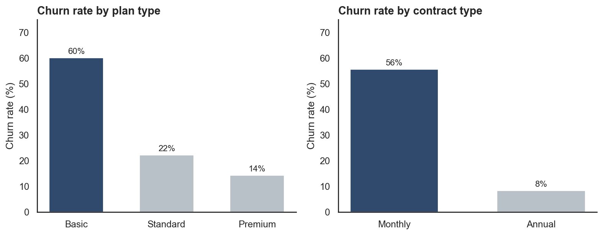

### Key insights
1. **Contract type is the strongest churn driver.** Monthly subscribers churn 6.7× more than annual subscribers.
2. **Escalations predict churn.** Every customer with an escalated complaint cancelled.
3. **Basic plan churns most (60%).** Premium brings in 55% of revenue with only 14% churn.
4. **Referral sign-ups are the least loyal** (83% churn), so the referral funnel brings in low-intent users.
5. **The customers we lose are low-value, short-tenure ones.** Churned CLTV averages Rs 341, against Rs 1,016 for retained customers.
6. **September 2024 was the peak churn month.** Karnataka and Meghalaya were the hardest-hit states.

### Recommendations
- Move monthly subscribers to annual plans with an incentive (for example, 2 months free).
- Treat every escalated complaint as a churn alert: resolve within 48 hours and add a goodwill credit.
- Tighten referral eligibility and extend onboarding for referral users.
- Test a content bundle or an upgrade path for Basic-plan users.
- Contact the medium/high-risk active customers first, in CLTV order.
- Check Karnataka and September 2024 for pricing changes, outages or competitor launches.

---

## Charts

| | |
|---|---|
| 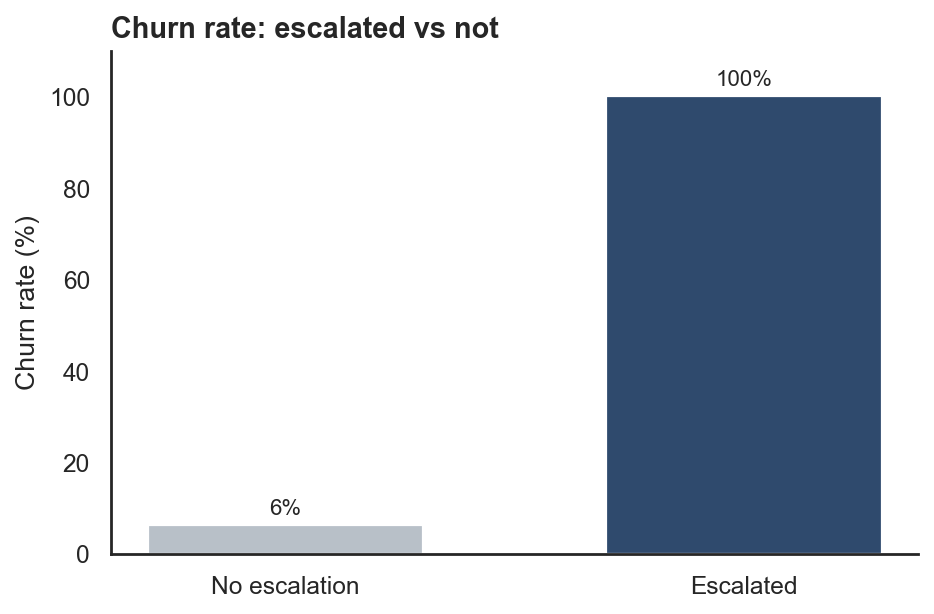 | 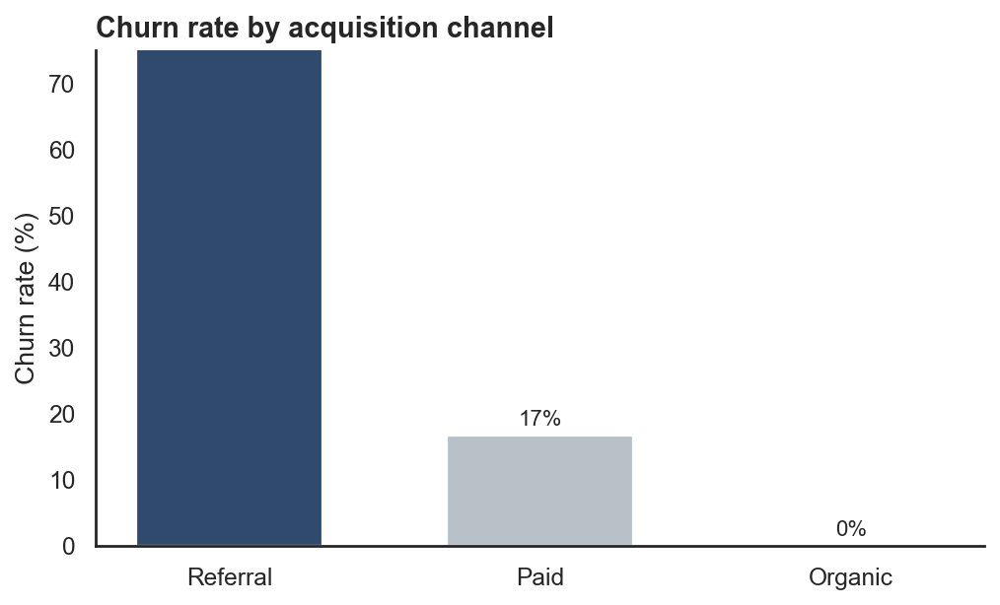 |
| 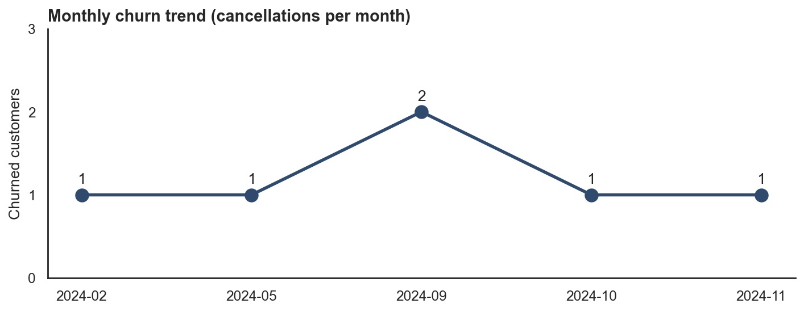 | 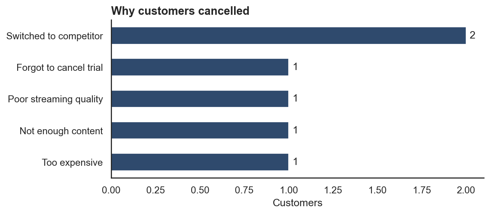 |
| 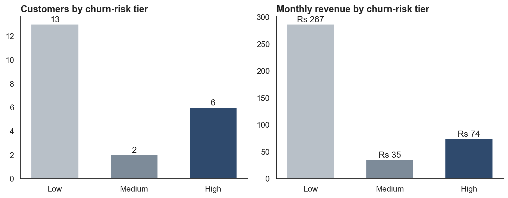 | 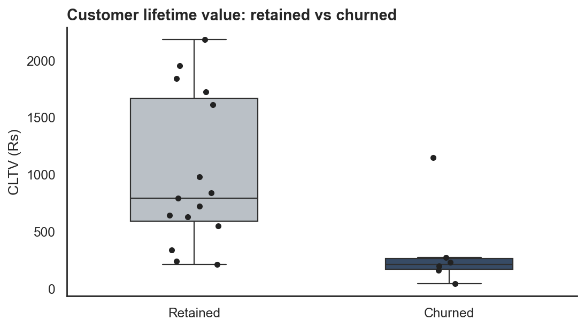 |
| 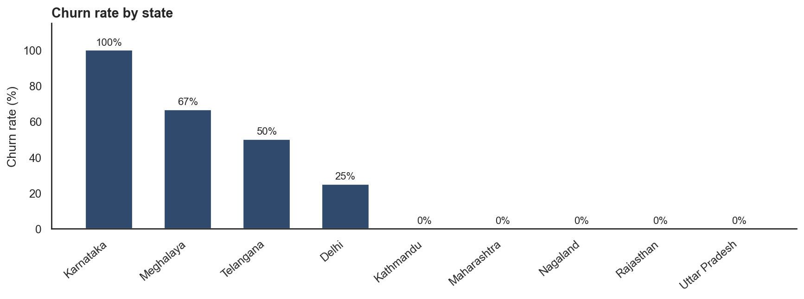 | 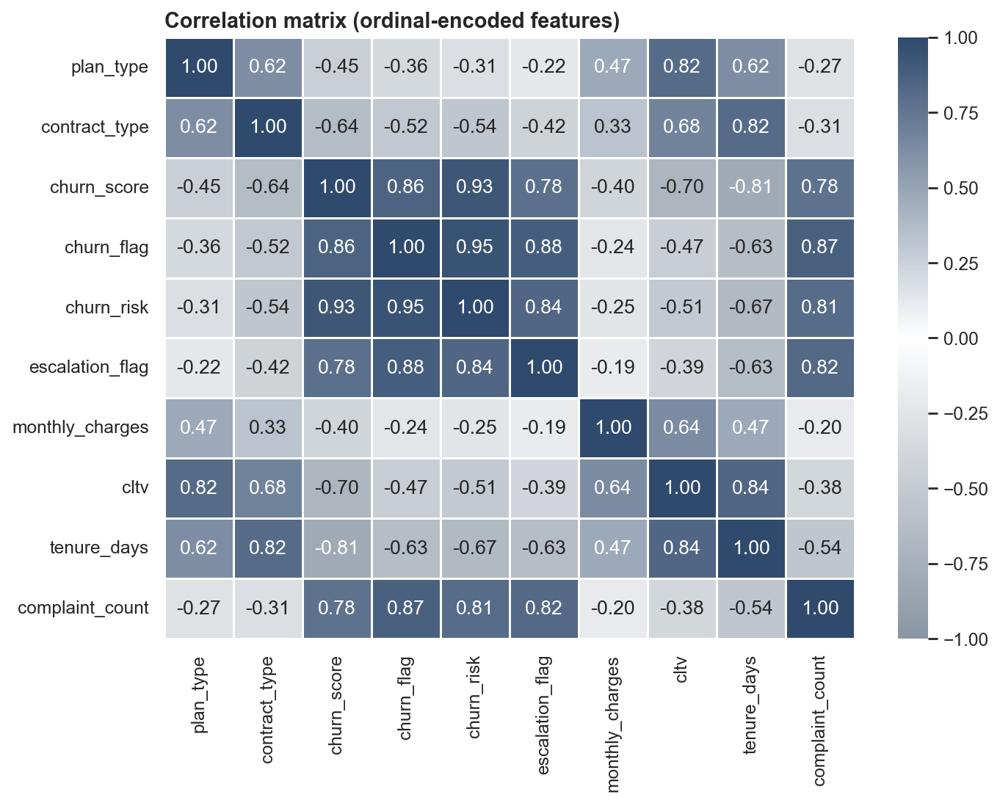 |

---

## How I built it

```
Excel (3 sheets) → SQLite → SQL queries → pandas → cleaning → feature engineering → joins → KPIs → SQL cross-check → charts → insights
```

1. **Data import:** loaded each Excel sheet into its own SQLite table, read the schema with `sqlite_master` / `PRAGMA table_info`, and queried the tables into pandas.
2. **Data quality checks:** profiled nulls, duplicates and inconsistent labels in every table.
3. **Cleaning:**
   - dropped empty columns (`pincode` 100% null, `interests` 81% null, `col_1`)
   - converted text dates to datetime
   - standardised gender labels and fixed the `Refferal` typo
   - filled missing countries from a state → country mapping
4. **Duplicate tickets:** two customers had two support tickets each, so a plain join would have produced 23 rows for 21 subscribers. I collapsed tickets to one row per customer and asserted that the row count stays at 21 after the join.
5. **Feature engineering:** churn flag, tenure, customer age and age band, complaint count, escalation flag, churn-risk tier.
6. **Analysis:** 20+ KPIs, segment analysis and pivot tables, with every headline KPI recomputed in SQL (`CASE WHEN`, `JOIN`, `GROUP BY`, `HAVING`).
7. **Visualisation:** Matplotlib/Seaborn charts, including an ordinal-encoded correlation heatmap. Plans are encoded in business order (Basic < Standard < Premium) because alphabetical codes would give misleading correlations.

| Raw data (Excel) | Data quality report |
|---|---|
| 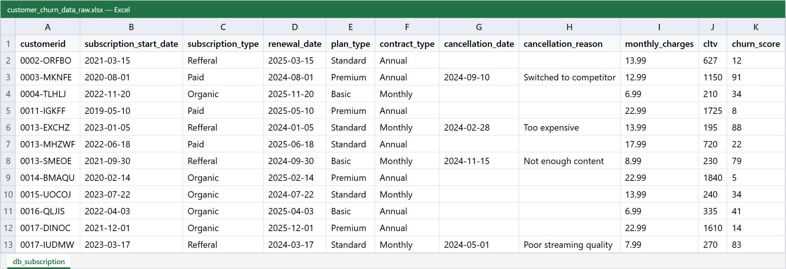 | 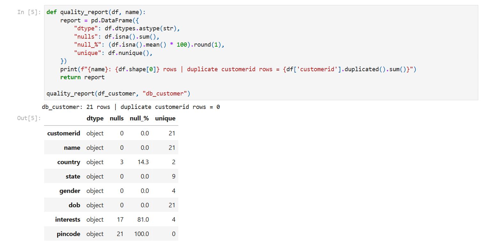 |
| **De-duplicating support tickets** | **KPI table** |
| 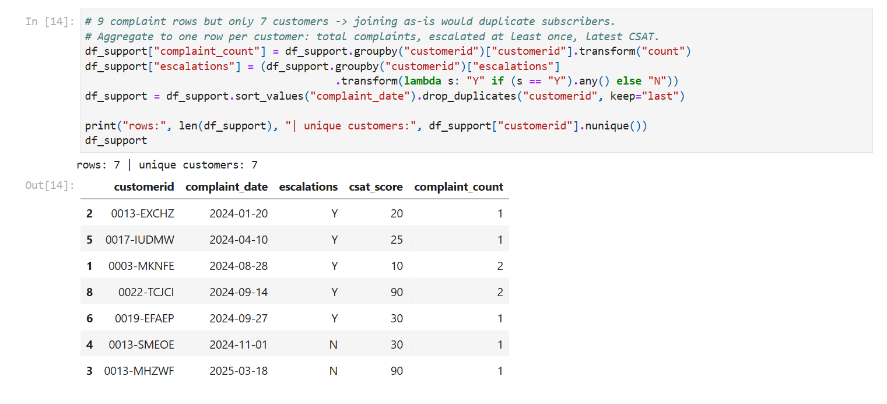 | 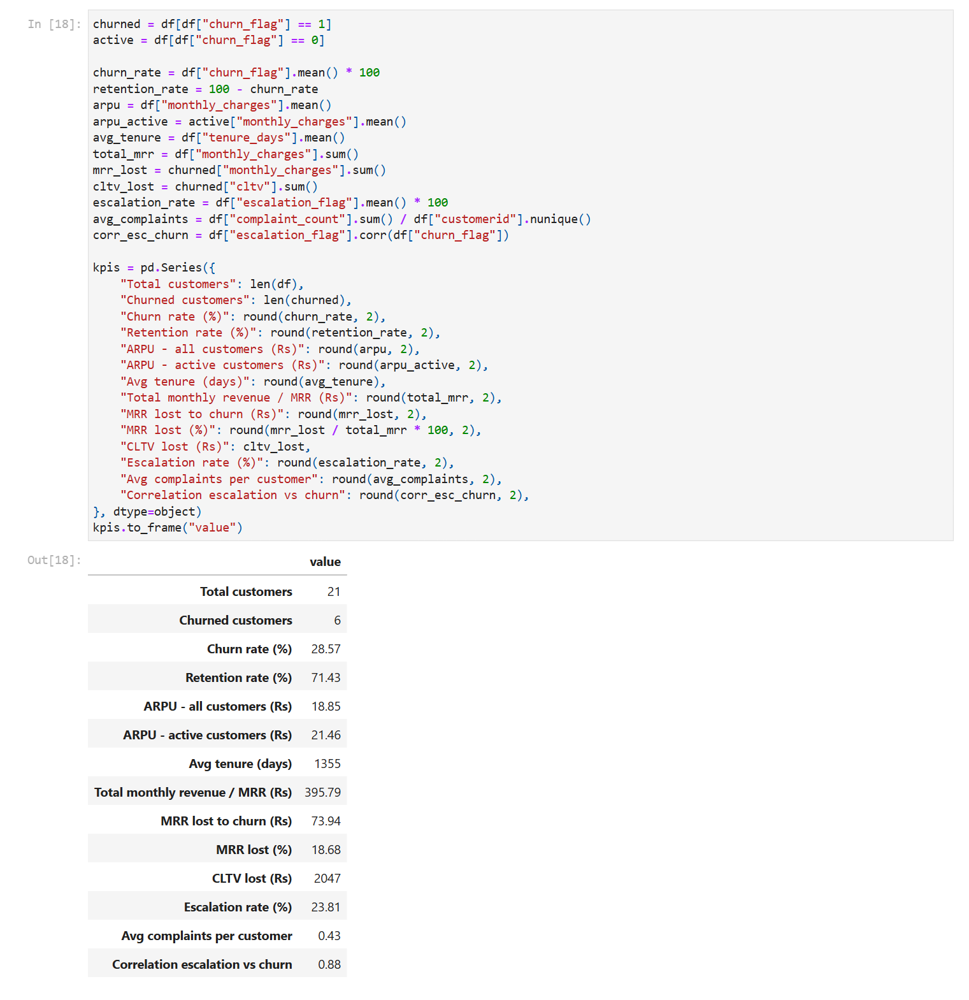 |
| **KPIs cross-checked in SQL** | **Running the pipeline** |
| 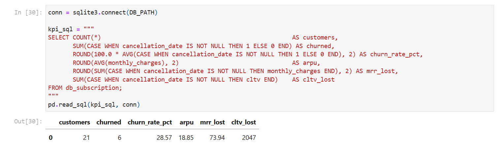 | 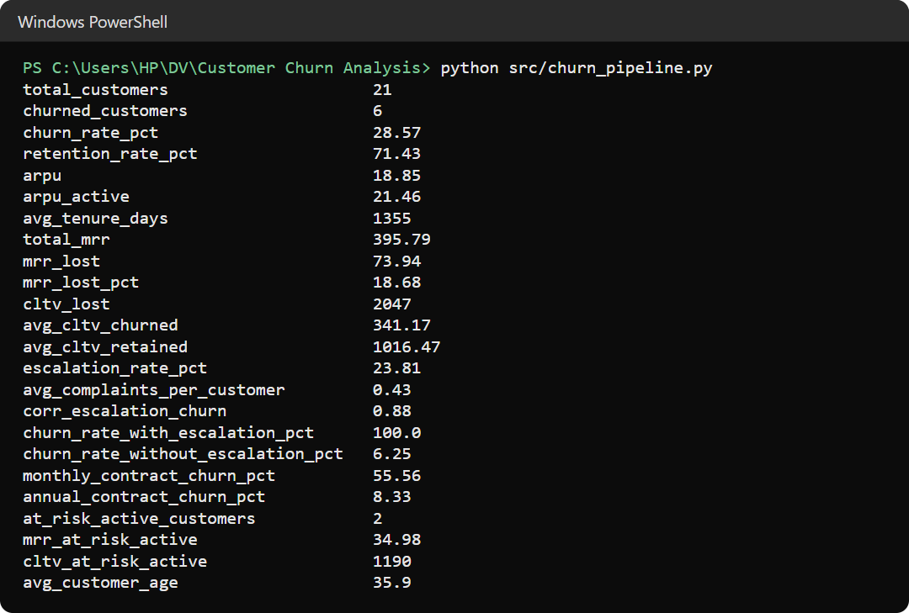 |

---

## Repository structure

```
Customer-Churn-Analysis/
├── data/
│   ├── raw/customer_churn_data_raw.xlsx    # source data: customer, subscription and support sheets
│   └── processed/
│       ├── churn_master_clean.csv          # cleaned, joined, customer-level table
│       └── kpi_summary.json                # all KPI values
├── notebooks/churn_analysis.ipynb          # full analysis, step by step, with outputs
├── src/churn_pipeline.py                   # same pipeline as one script: rebuilds the database, outputs and charts
├── images/
│   ├── charts/                             # exported charts
│   └── screenshots/                        # notebook and output screenshots
├── reports/Customer_Churn_Analysis_Report.pdf
├── presentation/Customer_Churn_Analysis.pptx
├── requirements.txt
└── LICENSE
```

## Data

| Table | Rows | Columns |
|---|---|---|
| `db_customer` | 21 | customerid, name, country, state, gender, dob, interests, pincode |
| `db_subscription` | 21 | customerid, subscription_start_date, subscription_type, renewal_date, plan_type, contract_type, cancellation_date, cancellation_reason, monthly_charges, cltv, churn_score |
| `db_support` | 9 | customerid, complaint_date, escalations, csat_score, col_1, comment |

A customer counts as **churned** when `cancellation_date` is present. Tenure and age are measured at a fixed snapshot date (31 Dec 2025), so every run gives the same results.

## Run it

```bash
git clone https://github.com/gauravkal006/Customer-Churn-Analysis.git
cd Customer-Churn-Analysis
pip install -r requirements.txt

python src/churn_pipeline.py                  # builds data/customer_churn.db, processed files and charts
jupyter notebook notebooks/churn_analysis.ipynb
```

## Limitations and next steps
- The sample is small (21 customers), so treat the rates as directional and confirm them on the full customer base.
- `churn_score` comes with the data. The next step is to train my own churn model (logistic regression or gradient boosting).
- Publish the KPIs as a Power BI or Tableau dashboard that refreshes from the SQL database.

## Acknowledgement
The dataset and problem statement come from a public data-analytics learning project by Rishabh Mishra. The cleaning logic, additional KPIs, SQL validation, visualisations, report and presentation are my own work.

---
**Gaurav Kalamkhede** · [GitHub @gauravkal006](https://github.com/gauravkal006)
